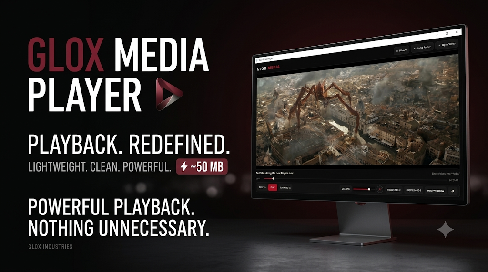

# Glox Media Player

**A modern, lightweight desktop media player built for simplicity, customization, and an immersive viewing experience.**

Glox Media Player is a desktop multimedia application developed under **Glox Industries** using Python and PySide6. It combines essential media playback functionality with a clean interface, customizable themes, and convenient viewing modes.

Designed to make watching videos simple, comfortable, and enjoyable.

---

## ✨ Features

- **Media Playback** – Play and pause videos with smooth playback controls.
- **Fullscreen Mode** – Enjoy videos in a distraction-free fullscreen environment.
- **Movie Mode** – A dedicated cinema-style viewing experience.
- **Mini Window Mode** – Switch to a compact, draggable player window.
- **Media Library** – Browse and access videos from your local Media folder.
- **Playlist Management** – Navigate and manage your video collection.
- **Drag & Drop Support** – Open media files by dragging them directly into the player.
- **Custom Themes** – Personalize the interface with multiple themes, including Gravity 3D.
- **Animated Visuals** – Includes a rotating disk animation during playback.
- **Keyboard Shortcuts** – Control playback and navigate without relying entirely on the mouse.

## 🛠️ Tech Stack

| Technology | Purpose |
|---|---|
| Python | Core application |
| PySide6 | Desktop GUI |
| Qt Multimedia | Media playback |
| PyInstaller | Windows executable packaging |

## 📸 Screenshots

Add your application screenshots here.

```text
screenshots/
├── main-window.png
├── movie-mode.png
├── mini-player.png
└── themes.png
```

## 🚀 Getting Started

### 1. Clone the repository

```bash
git clone https://github.com/AvgLucer/GloxMediaPlayer.git
```

```bash
cd GloxMediaPlayer
```

### 2. Install dependencies

```bash
pip install PySide6
```

### 3. Run the application

```bash
python gloxmp.py
```

## 📦 Building an Executable

You can package Glox Media Player into a standalone Windows executable using PyInstaller.

```bash
pip install pyinstaller
```

Example build command:

```bash
pyinstaller --onefile --windowed --name GloxMediaPlayer gloxmp.py
```

The generated executable will be available inside the `dist` directory.

*Note: Additional media plugins, assets, and application resources may need to be bundled depending on your implementation.*

## 📁 Project Structure

```text
GloxMediaPlayer/
│
├── gloxmp.py
├── banner.png
├── README.md
├── assets/
├── themes/
└── screenshots/
```

*The structure above is illustrative; adjust it to match your actual repository.*

## 🎨 Philosophy

Glox Media Player is built around three ideas:

- **Simplicity:** Essential controls without unnecessary clutter.
- **Customization:** A personalized viewing experience.
- **Performance:** A lightweight desktop application designed for everyday media playback.

## ⚠️ Disclaimer

This project is intended for personal, educational, and demonstration purposes.

Glox Media Player is an independent project developed under Glox Industries. It is not affiliated with or endorsed by any third-party media platform.

## 👨‍💻 Developer

**AvgLucer | Gaurav W**  
CEO at Glox Industries & Founder

---

<p align="center">
  <b>Glox Media Player</b><br>
  Made with ❤️ by Glox Industries
</p>
